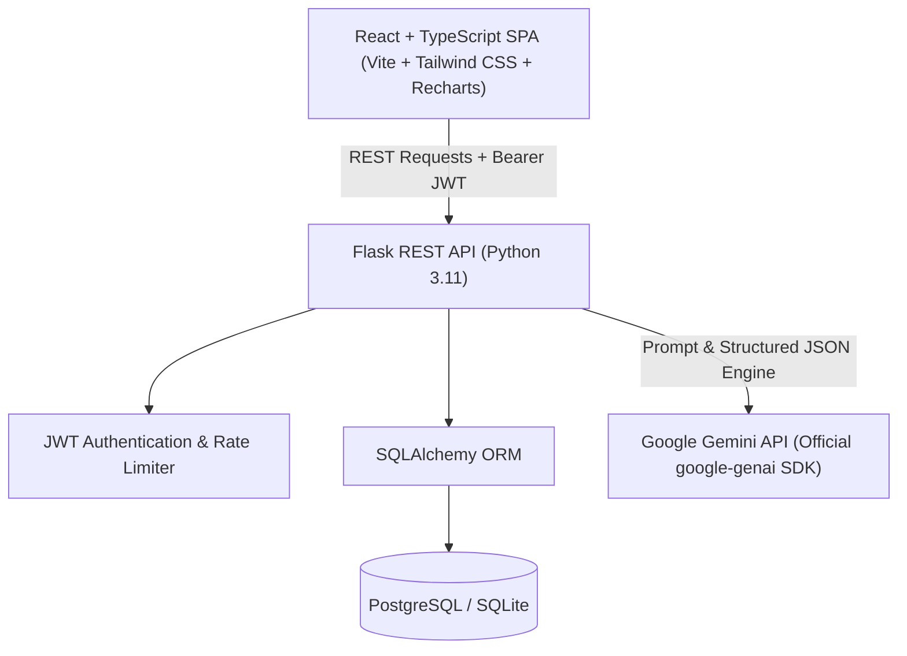

# InterviewAI - AI Mock Technical Interview Platform

[](https://python.org)
[](https://flask.palletsprojects.com/)
[](https://react.dev)
[](https://www.typescriptlang.org/)
[](https://tailwindcss.com/)
[](https://ai.google.dev/)

**InterviewAI** is a full-stack, AI-powered mock technical interview platform designed to prepare software engineers for top-tier technical evaluations. Candidates can practice across **Full Stack**, **Backend Systems**, and **Data/ML** tracks with timed questions, real-time multidimensional scoring, adaptive AI follow-up questions, and actionable 5-point improvement plans.

---

## Architecture Overview



---

## Key Features

1. **JWT Authentication & Security**: Secure user registration and login with bcrypt password hashing and token-based authentication.
2. **Customized Technical Interviews**: Pick from 3 engineering tracks (**Full Stack**, **Backend**, **Data/ML**), 3 difficulty tiers (**Easy**, **Medium**, **Hard**), and 3–10 questions.
3. **Automated Question Generation**: Powered by Google Gemini API via the official `google-genai` SDK, returning strict, validated JSON.
4. **Adaptive Follow-Up Questions**: After submitting an answer, the AI detects gaps or nuances and dynamically generates 1 sharp adaptive follow-up.
5. **3-Dimensional Evaluation**: Granular scoring out of 10 for:
   - **Correctness**: Accuracy of definitions, algorithms, and architectures.
   - **Clarity**: Structure, concise communication, and explanation flow.
   - **Depth**: Awareness of trade-offs, edge cases, and high-concurrency pitfalls.
6. **Senior-Level Ideal Answer Outlines**: Instant outline comparison showing what a senior engineer's response covers.
7. **Comprehensive Final Report**: Overall percentage score, performance tier badge, demonstrated strengths, weak areas, and a personalized **5-Point Actionable Improvement Plan**.
8. **Interactive Analytics Dashboard**: Performance progression line chart (`recharts`), weakest technical topics radar/bars, and complete history of past interviews.
9. **Dark Mode & Modern Responsive UI**: Polished responsive design with light/dark theme toggle, countdown timer, and loading states.
10. **LLM Provider Isolation**: All Gemini logic is encapsulated in `llm_service.py` with automatic retries and fallback mechanisms.

---

## Repository Structure

```text
aiinterview/
├── client/                     # Frontend application (React + Vite + Tailwind CSS)
│   ├── public/                 # Static assets
│   ├── src/
│   │   ├── api/                # API client endpoints (auth, interview, dashboard)
│   │   ├── components/         # Reusable UI (Navbar, Timer, LoadingSpinner, etc.)
│   │   ├── context/            # Global state (AuthContext, ThemeContext)
│   │   ├── pages/              # Views (Landing, Login, Register, Dashboard, Session, Report)
│   │   ├── types/              # TypeScript declarations
│   │   ├── App.tsx             # Routes and layout
│   │   ├── index.css           # Tailwind directives
│   │   └── main.tsx            # Application entrypoint
│   ├── .env.example            # Frontend environment template
│   ├── vercel.json             # Vercel deployment configuration
│   └── package.json            # Node dependencies
├── server/                     # Backend REST API (Flask + SQLAlchemy)
│   ├── app/
│   │   ├── routes/             # REST blueprints (auth, interviews, questions, dashboard)
│   │   ├── services/           # LLM service (llm_service.py with google-genai)
│   │   ├── utils/              # Auth decorators, rate limiting
│   │   ├── models.py           # SQLAlchemy entities (User, Interview, Question, Answer)
│   │   ├── database.py         # DB instance definition
│   │   └── config.py           # Configuration management
│   ├── tests/                  # Pytest test suite
│   ├── .env.example            # Backend environment template
│   ├── Dockerfile              # Docker production image
│   ├── render.yaml             # Render deployment blueprint
│   ├── requirements.txt        # Python dependencies
│   └── run.py                  # Server entrypoint
└── README.md                   # System documentation
```

---

## Local Setup & Quickstart

### Prerequisites
- **Python 3.11+**
- **Node.js 18+** and **npm**
- (Optional) **Google Gemini API Key** from [Google AI Studio](https://aistudio.google.com/)

---

### Step 1: Backend Setup

1. Navigate to the `server/` directory:
   ```bash
   cd server
   ```

2. Create and activate a Python virtual environment:
   ```bash
   # Windows (PowerShell)
   python -m venv venv
   .\venv\Scripts\Activate.ps1

   # macOS / Linux
   python3 -m venv venv
   source venv/bin/activate
   ```

3. Install dependencies:
   ```bash
   pip install -r requirements.txt
   ```

4. Configure environment variables:
   ```bash
   cp .env.example .env
   ```
   Edit `.env` to configure your Gemini API Key and settings:
   ```env
   FLASK_ENV=development
   SECRET_KEY=dev-secret-key-change-in-production-interviewai
   DATABASE_URL=sqlite:///interviewai.db
   GEMINI_API_KEY=your_gemini_api_key_here
   GEMINI_MODEL=gemini-2.5-flash
   PORT=5000
   ```

5. Run database initialization and start the backend:
   ```bash
   python run.py
   ```
   The Flask API will start on `http://127.0.0.1:5000`.

---

### Step 2: Frontend Setup

1. In a new terminal, navigate to the `client/` directory:
   ```bash
   cd client
   ```

2. Configure environment variables:
   ```bash
   cp .env.example .env
   ```

3. Install npm packages:
   ```bash
   npm install
   ```

4. Start the Vite development server:
   ```bash
   npm run dev
   ```
   Open `http://localhost:5173` in your browser.

> **Tip**: You can use the **Quick Demo Login** button on the Login page to instantly explore the dashboard and start mock interviews!

---

## Running the Automated Test Suite

InterviewAI includes a suite of unit and integration tests using `pytest` that mock external LLM API calls:

```bash
cd server
python -m pytest -v
```

Tests cover:
- User registration and duplicate validation.
- User authentication and JWT payload verification.
- Protected profile retrieval.
- Mock interview creation and question generation.
- Answer submission, scoring, and adaptive follow-up generation.
- Interview final report synthesis.
- Dashboard analytics and score trajectory calculation.

---

## REST API Reference

All endpoints are prefixed with `/api`.

### Authentication
| Method | Endpoint | Description | Auth Required |
|---|---|---|---|
| `POST` | `/api/auth/register` | Register a new user (`email`, `username`, `password`) | No |
| `POST` | `/api/auth/login` | Log in and receive JWT token | No |
| `GET` | `/api/auth/me` | Fetch profile of current user | Yes (Bearer) |

### Interviews
| Method | Endpoint | Description | Auth Required |
|---|---|---|---|
| `POST` | `/api/interviews` | Create interview & generate questions via Gemini | Yes (Bearer) |
| `GET` | `/api/interviews` | List current user's past interviews | Yes (Bearer) |
| `GET` | `/api/interviews/<id>` | Get interview details, questions, and answers | Yes (Bearer) |
| `POST` | `/api/interviews/<id>/complete` | Finalize interview and generate report | Yes (Bearer) |
| `GET` | `/api/interviews/<id>/report` | Get completed interview report | Yes (Bearer) |

### Questions & Answers
| Method | Endpoint | Description | Auth Required |
|---|---|---|---|
| `POST` | `/api/questions/<id>/answer` | Submit answer for evaluation & follow-up | Yes (Bearer) |
| `GET` | `/api/questions/<id>` | Get question details | Yes (Bearer) |

### Dashboard Analytics
| Method | Endpoint | Description | Auth Required |
|---|---|---|---|
| `GET` | `/api/dashboard/stats` | Metrics, score progression, and topic breakdown | Yes (Bearer) |

---

## Deployment Configuration

### 1. Backend on Render
The repository includes a ready-to-deploy [`render.yaml`](server/render.yaml) blueprint:
1. Push your repository to GitHub / GitLab.
2. In [Render](https://render.com), select **New > Blueprint** and link the repository.
3. Render will provision:
   - A managed **PostgreSQL** database.
   - A **Python web service** running `gunicorn --bind 0.0.0.0:$PORT run:app`.
4. Set the `GEMINI_API_KEY` in your Render Environment Variables.

### 2. Frontend on Vercel
The frontend is configured with [`vercel.json`](client/vercel.json):
1. Import the `client/` root into [Vercel](https://vercel.com).
2. Framework preset: **Vite**.
3. Set Environment Variable:
   - `VITE_API_BASE_URL`: `https://your-render-backend.onrender.com/api`
4. Deploy!

### 3. Docker Deployment
You can build and run the backend via Docker:
```bash
cd server
docker build -t interviewai-api .
docker run -p 5000:5000 -e GEMINI_API_KEY="your_key" interviewai-api
```

---

## Screenshots Placeholder

| Landing Page & Tracks | Performance Dashboard |
|:---:|:---:|
| *(Landing Page screenshot: Hero, track picker & features)* | *(Dashboard screenshot: Recharts line chart & weak topics)* |

| Live Interview Session & Timer | Final Evaluation Report |
|:---:|:---:|
| *(Session screenshot: Countdown timer, question card & feedback)* | *(Report screenshot: Overall score, strengths & 5-point plan)* |

---

## License
MIT License. Built with passion for software engineering excellence.
